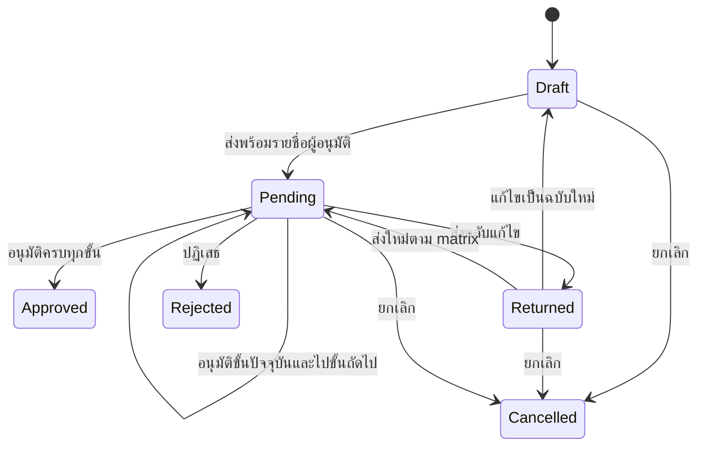

# ผลแก้ไขและทดสอบ flow ระบบ DMS

ตรวจเสร็จ: 15 ตุลาคม 2569 (2026-10-15)  
ขอบเขต: ระบบปัจจุบันใน repository เน้นการใช้งานจริง ไม่ยึดเอกสาร requirement เก่าที่ไม่ตรงกับระบบแล้ว

## ผลที่ยืนยันได้

- ทดสอบผ่าน Nest HTTP API และ PostgreSQL จริงใน schema แยก: **30/30 กลุ่มกรณี ผ่านทั้งหมด**
- Server compile ผ่าน และ production build ของ Next.js ผ่านโดยเปิดตรวจ TypeScript; ตรวจ `tsc --noEmit` ซ้ำหลังล้าง build ทดสอบผ่าน และ `git diff --check` ผ่าน
- ตรวจ PDF ที่สร้างจริง: PR/PO/BK อย่างละ 1 หน้า และ DOC fixture 2 หน้า ตรวจลายเซ็น ข้อความ ยอดเงิน และการลงนามที่หน้า 2
- ฐานข้อมูลใช้งานเดิมคงจำนวนเอกสาร **127** รายการ เวอร์ชัน **252** รายการ ผู้ใช้ **8** ราย ไม่ใช้ข้อมูลจริงในการทดสอบสร้าง/อนุมัติ
- เก็บกวาด schema ทดสอบทั้งหมดแล้ว รายละเอียดใน [scratch-cleanup.json](verification/scratch-cleanup.json)
- ผลนี้ยืนยันกรณีที่ทดสอบตามตาราง ไม่ใช่คำรับรองว่าซอฟต์แวร์ไม่มีข้อผิดพลาดทุกสถานการณ์

## สิ่งที่แก้

| ส่วนงาน | พฤติกรรมหลังแก้ |
|---|---|
| PR / PO / BK | บันทึกข้อมูลฟอร์ม รายการ วันที่ และการมองเห็นจริง ปรับ PR ไม่คิด VAT; PO รองรับ VAT 0 และอัตราต่อรายการ ตรวจชนิดข้อมูลและยอดเงินที่ server |
| DOC / ประเภท PDF ที่เพิ่มใน master data | ตรวจ PDF และขนาดไฟล์ ใช้ matrix ของประเภทนั้น แก้ร่างได้โดยใช้ไฟล์เดิม หรืออัปโหลดฉบับใหม่ |
| หน้าสร้างเอกสาร | วันที่ต้องการ/ส่งมอบเป็นอนาคตได้ ราคาเป็นทศนิยมได้ เลือกประเภทที่เปิดใช้งาน แผนกตรงกับผู้สร้าง ไม่สร้างเลขเอกสารหลอกใน browser |
| รายชื่อผู้อนุมัติ | ใช้ UUID ของผู้ใช้จริง ตรวจบทบาทและสิทธิ์ตาม matrix ที่ server ไม่แทนผู้อนุมัติด้วยคนอื่นที่มี role เดียวกัน และไม่จับคู่ด้วยชื่อที่อาจซ้ำ |
| ลำดับอนุมัติ | ทำรายการได้เฉพาะคนที่ถูกกำหนดในขั้นปัจจุบัน ตรวจ expected step/version ป้องกันการกดซ้ำหรือใช้หน้าจอเก่า |
| ลายเซ็น | ใช้ PNG/JPEG ที่ลงทะเบียนไว้ ตรวจข้อมูลภาพ เก็บเข้ารหัส ต้นฉบับมีการตรวจสิทธิ์ ลงภาพลง PDF จริงและบันทึกเวอร์ชันใหม่ |
| ความคงเดิมของลายเซ็น | เมื่อลงนามแล้ว ภาพของผู้จัดทำและผู้อนุมัติขั้นก่อนหน้าคงเดิม แม้แก้โปรไฟล์หรือเปลี่ยนลายเซ็นก่อนขั้นถัดไป |
| ข้อความ/วันที่ลงนาม | บันทึกลง PDF จริง แยกตำแหน่งตามลายเซ็นของแต่ละขั้น ไม่วางข้อความทุกคนทับที่เดียวกัน |
| Version control | เก็บ PDF จริงและ snapshot ของข้อมูล/บริษัท/ผู้จัดทำ/สายอนุมัติ ประวัติเวอร์ชันเปิดไฟล์ที่บันทึกไว้ ตรวจสิทธิ์อ่านเวอร์ชันเก่าที่ API |
| ส่งกลับแก้ไข | Returned แก้ไขและส่งใหม่ได้ เก็บประวัติสายอนุมัติรอบก่อน ไม่ทับเนื้อหาเวอร์ชันเก่า |
| สถานะสิ้นสุด | Approved / Rejected ไม่รับการอนุมัติหรือแก้ไขร่างซ้ำ Cancel แยกจาก soft delete และนำออกจาก inbox |
| เลขรัน/การทำงานพร้อมกัน | ใช้ transaction และ advisory lock ป้องกันเลขซ้ำและการอนุมัติชนกัน ตรวจรูปแบบปี ตัวคั่น padding และการตั้ง counter |
| ดาวน์โหลด/ความเป็นส่วนตัว | ตรวจ permission และ visibility ก่อนอ่านเอกสาร ไฟล์ และลายเซ็น ไม่มี public static route สำหรับไฟล์ที่ควรป้องกัน ไม่ส่ง hash รหัสผ่าน/reset token/ภาพลายเซ็นเข้ารหัสกลับในข้อมูลเอกสาร |
| โฟลเดอร์ | ตรวจสิทธิ์และการมองเห็น แสดงจำนวนเอกสารตามสิทธิ์ ตรวจการย้ายเอกสาร เก็บลงโฟลเดอร์แผนกเมื่ออนุมัติครบตามเงื่อนไข และใช้ soft delete |
| Master data | บันทึก matrix/เลขรัน/ข้อมูลบริษัทจริง ตรวจ role ก่อนเปลี่ยน matrix เก็บ audit ปิด/คืนสถานะแผนกและตำแหน่งได้ ไม่สร้าง role แฝงจากชื่อที่พิมพ์ |
| ผู้ใช้และ role | ใช้รหัสผ่านที่กำหนดจริง บันทึกสถานะผู้ใช้ ไม่อ้างสิทธิ์สูงสุดจากชื่อ Administrator เพียงอย่างเดียว บัญชี/role ที่ปิดและรหัสผ่านที่เปลี่ยนทำให้ session เดิมใช้ต่อไม่ได้ |
| แจ้งเตือน/รายงาน | แจ้งผู้อนุมัติขั้นถัดไปและผู้สร้าง บันทึก read_at แยกผู้ใช้ ใช้ข้อมูลจริงสำหรับยอด/สถานะ/dashboard และเก็บประวัติการตีกลับ |
| การรับมือข้อผิดพลาด | ความผิดพลาดของลายเซ็น/PDF rollback ทั้งขั้นและสถานะ คืน error ให้หน้าเว็บ แก้ข้อความสำเร็จหลอกเมื่อสร้างผู้ใช้ไม่สำเร็จ และรองรับลองเปิด PDF renderer ใหม่เมื่อเริ่ม browser ล้มเหลวชั่วคราว |
| Build | ปิด ignoreBuildErrors; ใช้ webpack สำหรับ production build หลังพบข้อผิดพลาดภายใน Turbopack/font resolver ในเครื่องนี้ |

## Flow สถานะที่ใช้งาน



ทุกการอนุมัติตรวจชื่อผู้ใช้ตาม UUID และขั้นที่กำหนด การแก้ร่างเป็นหน้าที่ของผู้สร้างเอกสาร การเห็นเอกสารไม่เท่ากับสิทธิ์แก้ไขหรืออนุมัติ

## หลักฐานและวิธีทดสอบซ้ำ

```powershell
Set-Location 'D:\Document Management\dms'
npm run test:flow
```

คำสั่งนี้ build server แล้วสร้าง schema `codex_flow_<timestamp>_<random>` จาก schema ปัจจุบัน สร้างบัญชีและเอกสารจำลอง ทดสอบผ่าน API จริง ใช้ SMTP sink ในเครื่อง แล้วลบเฉพาะ schema ทดสอบของรอบนั้น ไม่ seed/migrate ข้อมูลจริง ต้องมี PostgreSQL ตามการเชื่อมต่อใน `server/.env` และ Chromium/Edge สำหรับสร้าง PDF

คำสั่ง `npm run test:e2e --workspace=server` ใช้ชุดเดียวกันแล้ว ส่วน Jest specs เก่าที่ผูกกับบัญชี seed และ Hello World ไม่ใช่หลักฐานของผลรอบนี้

- [ผล API/ฐานข้อมูลรายกรณี](verification/e2e-results.json)
- [stdout คำสั่ง test:flow](verification/flow-test-final.txt)
- [ผล production build](verification/client-build-final.txt)
- [สรุปผลแบบ JSON](verification/verification-summary.json)
- [ผล ESLint server](verification/server-lint-final.json) / [client](verification/client-lint-final.json)
- ตัวอย่าง PDF และ PNG สำหรับ QA อยู่ใน `verification/` ใช้ข้อมูลและลายเซ็นจำลองที่ระบุ TEST SIGNATURE

การตรวจหน้าเว็บรอบต้นทดสอบล็อกอิน สร้าง PR เลือก visibility/รายชื่อ ส่งเรื่อง และอนุมัติได้จริง รอบสุดท้ายเครื่องมือ browser โหลดโมดูลไม่ได้เนื่องจากสิทธิ์เครื่องมือ จึงไม่มี screenshot รอบสุดท้าย ใช้ production build, HTTP integration และ render PDF เป็นหลักฐานปิดท้าย

## รายการทดสอบจริง

| ลำดับ | กลุ่มกรณีจาก test runner | ผล |
|---|---|---|
| 1 | HTTP requires authentication for documents/workflow/signature | ผ่าน |
| 2 | Empty-permission user cannot change approval master | ผ่าน |
| 3 | Signature accepts real PNG; rejects corrupt bytes and SVG | ผ่าน |
| 4 | Creation permission and nested item input enforced | ผ่าน |
| 5 | Invalid master update preserves previous steps | ผ่าน |
| 6 | PR: Draft, private visibility, named approvals, signed download, immutable versions | ผ่าน |
| 7 | PO: Draft, private visibility, named approvals, signed download, immutable versions | ผ่าน |
| 8 | BK: Draft, private visibility, named approvals, signed download, immutable versions | ผ่าน |
| 9 | DOC: Draft, private visibility, named approvals, signed download, immutable versions | ผ่าน |
| 10 | Return/edit/resubmit preserves previous form and previous workflow history | ผ่าน |
| 11 | DOC edit reuses existing file without uploading a replacement | ผ่าน |
| 12 | Cancel stops inbox and prevents approval; soft delete is separate | ผ่าน |
| 13 | Concurrent creation allocates distinct running numbers | ผ่าน |
| 14 | Concurrent approvals have one winner and one conflict | ผ่าน |
| 15 | Signature/PDF failure rolls back step, document and versions | ผ่าน |
| 16 | Inactive user and inactive role invalidate existing JWT | ผ่าน |
| 17 | Notification read_at and user scope | ผ่าน |
| 18 | Running settings persist and partial update keeps year valid | ผ่าน |
| 19 | Master departments use soft delete and can be restored | ผ่าน |
| 20 | Folder visibility, document visibility and move permissions are enforced | ผ่าน |
| 21 | Signature management persists, clears original only, preserves signed PDF | ผ่าน |
| 22 | Dashboard respects visibility; returns real counts | ผ่าน |
| 23 | Password reset delivers through local SMTP sink, consumes token once and revokes old JWT | ผ่าน |
| 24 | Legacy current version freezes before editing or approval | ผ่าน |
| 25 | Admin creates users with chosen password and inactive status; password reset revokes sessions | ผ่าน |
| 26 | Custom master document type uploads and signs a PDF using its own matrix | ผ่าน |
| 27 | Company settings persist and previous versions keep their frozen company | ผ่าน |
| 28 | Version history permission protects history API and historical file reads | ผ่าน |
| 29 | Later approvals preserve prior signer image and creator image after profile changes | ผ่าน |
| 30 | Read-only primary schema unchanged by tests | ผ่าน |

กรณี legacy ในชุดนี้รวมการยืนยันว่าเวอร์ชันเก่าที่ไม่มีทั้งไฟล์และ snapshot จะตอบข้อผิดพลาด ไม่ใช้ข้อมูลปัจจุบันไปสร้างเป็นต้นฉบับย้อนหลัง

## ข้อจำกัดและการตั้งค่าก่อนใช้จริง

1. **ข้อมูลเก่าที่ไม่เคยเก็บไฟล์/ภาพลายเซ็น:** ผลตรวจฐานข้อมูลเดิมพบ 95 ขั้นการลงนามที่ไม่มี PDF รองรับ ตัวเลขนี้เป็นจำนวนขั้น ไม่ใช่จำนวนเอกสาร โค้ดใหม่ไม่สามารถกู้ภาพเดิมที่ไม่เคยถูกบันทึกไว้ ไม่เอาภาพโปรไฟล์ปัจจุบันไปประทับย้อนหลัง ระบบแสดงคำเตือนในข้อมูลเก่า และปฏิเสธการสร้างประวัติแทนเมื่อไม่มีต้นฉบับ สำหรับหลักฐานการสาธิต ควรสร้างเอกสารชุดใหม่หลังใช้โค้ดที่แก้แล้ว
2. **อีเมลรีเซ็ตรหัสผ่าน:** ยังไม่มี SMTP จริงใน environment เดิม ทดสอบส่งผ่าน SMTP sink สำเร็จ ลิงก์ใช้ได้ครั้งเดียวและทำให้ JWT เก่าใช้ต่อไม่ได้ หากไม่ตั้ง SMTP จะแจ้งให้ติดต่อผู้ดูแล ผู้ดูแลรีเซ็ตรหัสผ่านผ่านระบบได้จริง ค่าใช้งานภายนอกคือ `SMTP_HOST`, `SMTP_PORT`, `SMTP_FROM` และ `SMTP_USER`/`SMTP_PASS` ตามบริการ รวมถึง `FRONTEND_URL` ที่เข้าถึงได้จริง
3. **กุญแจลายเซ็น:** ถ้าไม่มี `ENCRYPTION_KEY` จะสร้างกุญแจเฉพาะเครื่องใน `server/.local/signature.key` ต้องสำรองพร้อมฐานข้อมูล อย่าลบหรือเปลี่ยนกุญแจเดิมเมื่อต้องอ่านลายเซ็นที่เก็บไว้
4. **PDF renderer:** เครื่องนี้ทดสอบกับ Chromium/Edge และฟอนต์ Tahoma ตั้ง `PDF_BROWSER_PATH` หรือ `PDF_FONT_PATH` ได้เมื่อเครื่องปลายทางติดตั้งต่างตำแหน่ง ยังไม่ได้ทดสอบ deployment บนเครื่องอื่นจริง
5. **คุณภาพ static analysis ยังไม่ผ่านทั้งหมด:** server มี 343 errors / 12 warnings; client มี 474 errors / 27 warnings ส่วนมากเป็น unsafe JSON/dynamic typing, explicit any, unused code และกฎ hooks ผลนี้ถูกเก็บตามจริง ไม่ปิดกฎเพื่อให้รายงานเป็นผ่าน ดังนั้นยังไม่ควรระบุในเล่มว่า lint ผ่านหรือ code quality ไม่มีข้อค้าง แม้ build และ flow integration ผ่าน
6. การทดสอบนี้ไม่ใช่การทดสอบ load ระดับ production, การทดสอบทุก browser หรือการรับรองทางกฎหมายของลายเซ็นภาพใน PDF

หลังอัปเดตโค้ดให้ restart server/client และเข้าสู่ระบบใหม่ เพราะมีการตรวจเวอร์ชันรหัสผ่านใน JWT ไม่ต้องแก้ schema ของฐานข้อมูลใช้งานเดิมเพื่อใช้การแก้ไขชุดนี้
